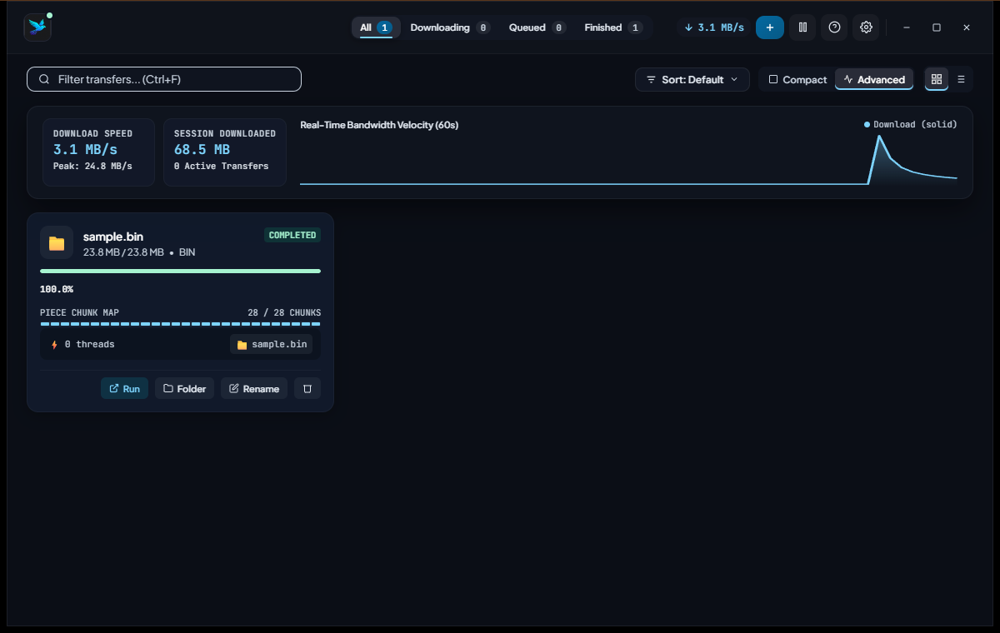

<div align="center">


# Kestrel Download Manager

**An accessible, keyboard-first desktop front end for the [aria2](https://aria2.github.io/) download engine.**

[](LICENSE)
[](ACCESSIBILITY.md)
[](https://tauri.app/)

</div>

Kestrel wraps aria2's fast multi-connection, BitTorrent and magnet engine in a small native window built with Tauri. It is designed to work equally well with a mouse, a keyboard alone, or a screen reader, and targets [WCAG 2.2 level AA](ACCESSIBILITY.md).

<p align="center">
  
</p>

## Contents

- [Features](#features)
- [Kestrel and aria2](#kestrel-and-aria2)
- [Requirements](#requirements)
- [Installation](#installation)
- [Building from source](#building-from-source)
- [Configuration](#configuration)
- [Security model](#security-model)
- [Keyboard shortcuts](#keyboard-shortcuts)
- [Browser companion extension](#browser-companion-extension)
- [Project structure](#project-structure)
- [Contributing](#contributing)
- [Acknowledgements](#acknowledgements)
- [License](#license)

## Features

- **HTTP(S), FTP, magnet links and BitTorrent** through aria2, with multi-connection downloads and resume.
- **Paste-and-go adding:** URLs, several URLs (one per line), magnet links, or a whole `curl` command copied from your browser's developer tools. Kestrel extracts the URL, cookies, referer and user agent automatically.
- **Stale-link detection:** if a server returns an HTML error or login page instead of the file, the transfer is flagged and Kestrel can try to resolve the real mirror link.
- **Transfer management:** pause, resume, rename, open, show in File Explorer, remove (optionally deleting the file), stop seeding, and clear finished items.
- **Compact and Advanced modes:** Advanced mode adds a live bandwidth chart, a piece map and per-transfer peer, seeder and ratio data.
- **Grid and list views**, search, sorting, and filters for downloading, queued and finished transfers.
- **Four colour themes** (Obsidian, Emerald, Nordic, Amethyst), all meeting WCAG AA contrast.
- **System tray** with pause all, resume all, an optional close-to-tray mode, and native completion notifications.
- **Browser companion extension** for Chromium browsers that hands matching downloads to Kestrel together with your session cookies.
- **Accessibility built in:** full keyboard operation, screen-reader names and live announcements, visible focus, text zoom up to 200%, reflow down to 320 CSS px, reduced-motion support and Windows High Contrast (forced colours) support. See [ACCESSIBILITY.md](ACCESSIBILITY.md).

## Kestrel and aria2

Every transfer is performed by [aria2](https://aria2.github.io/), or by [Kestrel Engine](engine/README.md), which is aria2 1.37.0 with the small changes in the second table. Kestrel is the window around that engine. Download speed, resume, and the protocol behaviour come from aria2.

| | Kestrel Download Manager | aria2 1.37.0 |
| --- | --- | --- |
| How you use it | A desktop window, a system tray, and the keyboard or a screen reader | `aria2c` on the command line, or JSON-RPC from another program |
| What moves the bytes | Kestrel Engine, or `aria2c` when that is the engine Kestrel finds | `aria2c` |
| Protocols | HTTP(S), FTP, magnet links, and BitTorrent | The same, and Metalink |
| Connections per server | Up to 64 with Kestrel Engine, and up to 16 with stock aria2 | Up to 16 |
| Resume | Yes, through the engine | Yes |
| Adding a download | Paste a URL, several URLs, a magnet link, or a `curl` command copied from the browser | Command-line arguments, an input file, or RPC |
| Signed-in downloads | The browser companion sends the cookies for that site | You pass cookies yourself, with `--header` or an input file |
| Stale or HTML error pages | The transfer is flagged, and Kestrel can try to resolve the real mirror link | You notice it from the log or the saved file |
| Progress | Transfer cards, a bandwidth chart, and a piece map | Log lines, or RPC if you build a client |
| Accessibility | Aimed at [WCAG 2.2 AA](ACCESSIBILITY.md) | The terminal |
| Platforms | Windows 10 and 11. macOS and Linux builds are untested | Windows, macOS, Linux, and others |
| Configuration | Preferences for the folder, connections per server, and seeding. Any other option still applies when it is set in `aria2.conf` | `aria2.conf` and command-line options |
| Licence | The app is [MIT](LICENSE). The bundled engine is [GPL-2.0-or-later](engine/COPYING) | GPL-2.0-or-later |

Opening many connections to one server can be treated as abuse. Some hosts throttle or ban clients that do it. The higher cap is a ceiling, and the value you save in Preferences is what the engine uses.

### What Kestrel Engine changes

| | Kestrel Engine 1.37.0-k1 | aria2 1.37.0 |
| --- | --- | --- |
| `--max-connection-per-server` | Up to 64 | Up to 16 |
| Version banner | Names Kestrel Engine and credits aria2 as the upstream | Names aria2 |
| `aria2.getVersion` | Also returns `engine` and `engineVersion`. The `version` field is still the aria2 version | Returns the aria2 version |
| Windows libraries | Newer zlib, Expat, SQLite, c-ares, and libssh2 | The versions shipped with official aria2 1.37.0 |
| User-Agent | `aria2/1.37.0` | `aria2/1.37.0` |
| BitTorrent peer ID | `A2-1-37-0-` | `A2-1-37-0-` |
| Other options and defaults | Unchanged | Unchanged |

The User-Agent and peer ID stay aria2's so servers and private trackers keep recognising the client. The patch, the library versions, and the licence are in [engine/README.md](engine/README.md).

## Requirements

| Component | Notes |
| --- | --- |
| Windows 10 or 11 | The supported platform today. Some features (toasts, Explorer integration, clipboard) use Windows APIs; macOS and Linux builds are untested. |
| [Microsoft Edge WebView2](https://developer.microsoft.com/microsoft-edge/webview2/) | Preinstalled on Windows 11 and current Windows 10. |
| A download engine | The installer and the portable build both include [Kestrel Engine](engine/README.md), a lightly modified aria2. A build from source without that binary needs [aria2](https://aria2.github.io/) 1.35 or newer. Kestrel starts the engine for you if it is not already running. |

If you are running from source and `kestrel-engine.exe` is not beside the app, install aria2 with WinGet:

```powershell
winget install aria2.aria2
```

Kestrel looks for an engine in this order:

1. The path in the `KESTREL_ARIA2C` environment variable.
2. `kestrel-engine.exe`, then `aria2c.exe`, next to `Kestrel Download Manager.exe`.
3. `%LOCALAPPDATA%\Microsoft\WinGet\Links`.
4. Any WinGet-installed `aria2.aria2` package.
5. `aria2c` on your `PATH`.

## Installation

Both builds are on the [Releases page](https://github.com/awm404/kestrel-download-manager/releases). Each one includes Kestrel Engine, so you do not install aria2 separately.

**Installer.** Download `Kestrel-Download-Manager-1.0.0-x64-setup.exe` and run it. It installs for the current user, with no administrator prompt, into `%LOCALAPPDATA%\Kestrel Download Manager`, and adds a Start menu shortcut. The welcome page uses Kestrel's own artwork. WebView2 is downloaded during setup if Windows does not already have it. The engine, the licence notices and the browser extension are installed next to the app.

**Portable.** Download `Kestrel-Download-Manager-1.0.0-portable-x64.zip`, unzip it, and run `Kestrel Download Manager.exe`. Nothing is added to the Start menu. You can keep the folder on a USB drive.

Settings for either build are stored in `%USERPROFILE%\.aria2`, not in the install folder.

On first launch a short feature tour opens. Use <kbd>→</kbd> and <kbd>←</kbd> to move through it, or <kbd>Esc</kbd> to skip it. You can reopen it at any time with the **Feature tour** button. Switch to **Advanced** in the toolbar for the bandwidth chart and piece map shown above.

## Building from source

Prerequisites:

- [Node.js](https://nodejs.org/) 18 or newer
- [Rust](https://www.rust-lang.org/tools/install) stable (via `rustup`)
- The [Tauri 2 prerequisites for Windows](https://tauri.app/start/prerequisites/) (Microsoft C++ Build Tools and WebView2)

```powershell
git clone https://github.com/awm404/kestrel-download-manager.git
cd kestrel-download-manager
npm install

# Run in development mode with hot reload of the front end
npm run dev

# Produce the app and the Windows installer
npm run build
```

The front end is a single dependency-free file, `src/index.html`, so no bundler step is needed.

`npm run build` writes `src-tauri/target/release/bundle/nsis/Kestrel Download Manager_1.0.0_x64-setup.exe`. The installer is branded with `src-tauri/nsis/header.bmp` and `sidebar.bmp`, and it copies `kestrel-engine.exe` plus the licence notices to the install folder. Build [Kestrel Engine](engine/README.md) first so `engine/dist/kestrel-engine.exe` exists; the bundle step stops if that file is missing.

The portable zip is assembled separately: copy `src-tauri/target/release/aria2-app.exe` to `Kestrel Download Manager.exe` and place `engine/dist/kestrel-engine.exe` in the same folder, along with `kestrel-extension/`, `LICENSE`, `THIRD_PARTY_NOTICES.md`, `engine/COPYING`, `engine/LICENSE.OpenSSL` and `engine/AUTHORS`.

## Configuration

Kestrel keeps its files in `%USERPROFILE%\.aria2` (override with `KESTREL_ARIA2_HOME`):

| File | Purpose |
| --- | --- |
| `aria2.conf` | Optional aria2 configuration. When present it is passed to aria2 with `--conf-path`. Kestrel updates its `dir=`, `max-connection-per-server=` and `split=` lines when you change those settings in Preferences. |
| `kestrel-rpc-secret` | The RPC secret Kestrel generated for aria2 (see [Security model](#security-model)). Created on first launch when `aria2.conf` has no `rpc-secret`. |
| `tauri_app.log` | Diagnostic log. Attach the relevant lines when reporting a bug. |

Without an `aria2.conf`, Kestrel starts aria2 with these settings:

```text
--enable-rpc=true  --rpc-listen-port=6800  --rpc-listen-all=false
--rpc-allow-origin-all=true  --continue=true  --dir=%USERPROFILE%\Downloads
--rpc-secret=<generated secret>
```

Starting from a config file? A minimal example:

```ini
# %USERPROFILE%\.aria2\aria2.conf
enable-rpc=true
rpc-listen-port=6800
rpc-listen-all=false
rpc-allow-origin-all=true
# Set your own secret, or omit this line and Kestrel will generate one.
rpc-secret=change-me-to-a-long-random-string
dir=C:/Users/you/Downloads
continue=true
max-connection-per-server=16
split=16
```

Other settings, such as the download folder, connections per server, seeding ratio, RPC address and secret, theme, layout and close-to-tray, are available in **Preferences** (<kbd>Ctrl</kbd>+<kbd>,</kbd>). Connections per server goes up to 64 with Kestrel Engine and up to 16 with stock aria2.

| Environment variable | Effect |
| --- | --- |
| `KESTREL_ARIA2_HOME` | Folder for `aria2.conf`, the generated secret and the log (default `%USERPROFILE%\.aria2`). |
| `KESTREL_ARIA2C` | Full path to the `aria2c` executable to launch. |

## Security model

aria2 is controlled through a JSON-RPC server on `127.0.0.1:6800`. Because aria2 also accepts RPC calls as plain HTTP GET requests, **any website you visit could send commands to an unprotected aria2**, for example to download a file into your Startup folder. Kestrel therefore always protects the RPC interface with a secret:

- If your `aria2.conf` sets `rpc-secret`, Kestrel uses it.
- Otherwise Kestrel generates a random 192-bit secret, stores it in `kestrel-rpc-secret`, and passes it to the aria2 process it starts.
- The desktop UI picks up the secret automatically. The browser extension needs it pasted once: copy it from **Preferences → BitTorrent & Swarm Acceleration → RPC Secret Token**.

If you run aria2 yourself (for example as a service), set `rpc-secret` in its configuration and enter the same value in Kestrel's Preferences.

See [SECURITY.md](SECURITY.md) for the full threat model and how to report vulnerabilities.

## Keyboard shortcuts

| Keys | Action |
| --- | --- |
| <kbd>Tab</kbd> / <kbd>Shift</kbd>+<kbd>Tab</kbd> | Move between controls. The first <kbd>Tab</kbd> reveals a **Skip to transfers** link. |
| <kbd>Ctrl</kbd>+<kbd>N</kbd> | Add a download |
| <kbd>Ctrl</kbd>+<kbd>F</kbd> | Search transfers |
| <kbd>Ctrl</kbd>+<kbd>,</kbd> | Open Preferences |
| <kbd>↑</kbd> <kbd>↓</kbd> <kbd>←</kbd> <kbd>→</kbd>, <kbd>Home</kbd>, <kbd>End</kbd> | Move between transfer cards |
| <kbd>Enter</kbd> on a transfer | Open a finished file, or pause/resume an active one |
| <kbd>Shift</kbd>+<kbd>F10</kbd> or <kbd>Menu</kbd> | Open the actions menu for the focused transfer |
| <kbd>Delete</kbd> | Remove the focused transfer (asks for confirmation; **Cancel** is focused first) |
| <kbd>↑</kbd> <kbd>↓</kbd>, <kbd>Home</kbd>, <kbd>End</kbd>, letters | Navigate inside menus |
| <kbd>Ctrl</kbd>+<kbd>Enter</kbd> | Start the download from the Add dialog |
| <kbd>Esc</kbd> | Close the open menu, dialog or tour and return focus to where you were |
| <kbd>Ctrl</kbd>+<kbd>+</kbd> / <kbd>Ctrl</kbd>+<kbd>-</kbd> / <kbd>Ctrl</kbd>+<kbd>0</kbd> | Zoom in / out / reset |

## Browser companion extension

The `kestrel-extension/` folder contains a Manifest V3 extension for Chrome, Edge, Brave and other Chromium browsers. It sends downloads with chosen file extensions, as well as links you pick from the right-click menu, to Kestrel together with the cookies your browser would send for that URL. That makes downloads from file hosters and links that need you to be signed in work.

Install it from **Preferences → Browser Companion Extension → Open Extension Folder**, then follow the steps in [kestrel-extension/README.md](kestrel-extension/README.md).

## Project structure

```text
.
├── src/                    Front end (single-file HTML/CSS/JS UI, loaded by WebView2)
│   ├── index.html
│   └── assets/
├── src-tauri/              Rust backend (Tauri 2)
│   ├── src/lib.rs          Commands: aria2 launch, file operations, tray, notifications
│   ├── src/main.rs         Entry point and single-instance handling
│   ├── tauri.conf.json     Window, bundle and security configuration
│   └── capabilities/       Tauri permission sets
├── kestrel-extension/      Chromium companion extension (Manifest V3)
├── engine/                 Kestrel Engine: aria2 patch and Docker build (GPL-2.0-or-later)
└── .github/                Issue and pull request templates
```

The UI talks to aria2 directly over JSON-RPC (`fetch` to `127.0.0.1:6800/jsonrpc`). It calls Rust commands through `window.__TAURI__.core.invoke` only for things a web page cannot do itself: launching files, Explorer integration, renaming and deleting files on disk, the native folder picker, the tray and notifications.

## Contributing

Bug reports, accessibility feedback and pull requests are welcome. Please read [CONTRIBUTING.md](CONTRIBUTING.md) and follow our [Code of Conduct](CODE_OF_CONDUCT.md). Accessibility regressions are treated as bugs, so please use the **Accessibility issue** template if something is hard to use with your setup.

## Acknowledgements

Kestrel would not exist without **[aria2](https://aria2.github.io/)** by Tatsuhiro Tsujikawa and the aria2 contributors. Every download Kestrel makes is performed by aria2 or by Kestrel Engine, our lightly modified build of it; Kestrel is the interface around it. If Kestrel is useful to you, consider [starring or supporting aria2](https://github.com/aria2/aria2).

The interface icons are based on [Feather Icons](https://feathericons.com/). See [THIRD_PARTY_NOTICES.md](THIRD_PARTY_NOTICES.md) for every third-party component and its licence.

## License

Kestrel is released under the [MIT License](LICENSE), **except the `engine/` directory**.

`engine/` contains Kestrel Engine, a modified version of aria2. Like aria2, it is licensed under the [GNU General Public License v2.0 or later](engine/COPYING). Kestrel's MIT code does not include engine source or link against it: it starts the engine as a separate program and talks to it over its RPC interface. The complete corresponding source of every engine binary is attached to each release that ships it. See [engine/README.md](engine/README.md) and [THIRD_PARTY_NOTICES.md](THIRD_PARTY_NOTICES.md).
